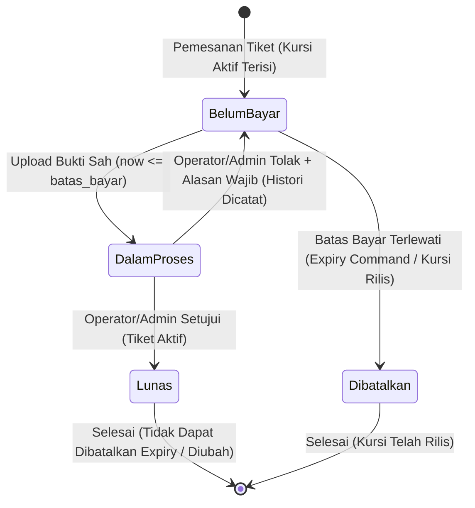

# 20 — Phase 4: Payment State Guard & Verification Implementation Report

> **Fase:** P0-04 (Critical Data Integrity & Payment State Guard)  
> **Tanggal Selesai:** 12 November 2026  
> **Status Implementasi:** **SELESAI (100% Passed Tests, Regression Clean, Main DB Migration Pending Approval)**

---

## 1. Ringkasan Masalah Awal

Berdasarkan audit menyeluruh pada Stage 1 sebelum implementasi, ditemukan kelemahan kritis pada alur verifikasi dan siklus hidup pembayaran:

1. **Ketiadaan Transaksionalitas & Concurrency Control:**
   - Method `verifikasi()` dan `tolak()` pada `Operator\VerifikasiPembayaranController` dan `Admin\PesananController` melakukan mutasi status tanpa `DB::transaction()` dan tanpa `lockForUpdate()`.
   - Mengakibatkan kerentanan balapan konkurensi (*race condition*) apabila dua operator/admin memproses pesanan yang sama secara bersamaan, atau jika request dikirim ganda karena double-click pada browser.

2. **Transisi Status Penolakan yang Menyimpang dari Aturan Bisnis:**
   - Pemanggilan `tolak()` sebelumnya langsung mengubah `pesanan.status` menjadi `StatusPesanan::Dibatalkan`.
   - Hal ini melanggar keputusan bisnis GOTIX yang telah disepakati: penolakan bukti oleh operator seharusnya mengembalikan status pesanan ke `Belum Bayar` agar penumpang memiliki kesempatan untuk mengunggah bukti perbaikan sebelum batas waktu pembayaran (`batas_bayar`) berakhir.

3. **Penolakan Tanpa Alasan & Hilangnya Jejak Audit:**
   - Endpoint `tolak()` tidak menerima input `alasan_penolakan` dan tidak melakukan validasi.
   - Kolom audit pada `konfirmasi_pembayaran` (`diverifikasi_oleh`, `diverifikasi_pada`, `alasan_penolakan`) tidak diisi saat verifikasi maupun penolakan.

4. **Penghancuran Bukti Transfer Historis (Data Destruction):**
   - Pada `Member\PembayaranController::konfirmasiStore`, saat member mengunggah ulang bukti pembayaran, berkas bukti lama langsung dihapus dari disk (`Storage::delete`), dan record pada `konfirmasi_pembayaran` ditimpa.
   - Mengakibatkan hilangnya bukti audit forensik ketika terjadi perselisihan pembayaran antara penumpang dan pengelola loket.

5. **Ketiadaan Pengecekan Batas Waktu Bayar pada Upload & Tidak Ada Mekanisme Expiry Otomatis:**
   - Member masih dapat mengunggah bukti pembayaran meskipun waktu telah melewati `batas_bayar`.
   - Tidak ada Laravel Console Command maupun Scheduled Task untuk membatalkan pesanan yang telah kedaluwarsa dan melepaskan reservasi kursi.

6. **Kerentanan File Orphan & Error Unhandled Resi Duplikat:**
   - Jika terjadi kegagalan database setelah berkas bukti disimpan ke disk, berkas baru tertinggal sebagai *orphan file*.
   - Validasi `nomor_resi` tidak menangani pengecualian keunikan terhadap record miliknya sendiri, berpotensi melempar unhandled 500 error.

7. **Typo Kolom pada Tampilan Antrean Operator:**
   - Pada `resources/views/operator/pembayaran/index.blade.php` L90, pemanggilan `$pesanan->konfirmasiPembayaran->nama_pengirim` menyebabkan tampilan nama pengirim kosong karena nama kolom yang benar adalah `rekening_pengirim`.

---

## 2. Struktur Kode Sebelum Perubahan

- `app/Http/Controllers/Operator/VerifikasiPembayaranController.php`:
  - `verifikasi($id)`: Hanya `$pesanan->update(['status' => StatusPesanan::Lunas])`.
  - `tolak($id)`: Hanya `$pesanan->update(['status' => StatusPesanan::Dibatalkan])`.
- `app/Http/Controllers/Admin/PesananController.php`:
  - `verifikasi($id)`: Serupa, langsung mutasi ke `Lunas` tanpa validasi status awal dan tanpa audit trail.
  - `tolak($id)`: Langsung mutasi ke `Dibatalkan` tanpa meminta `alasan_penolakan`.
- `app/Http/Controllers/Member/PembayaranController.php`:
  - Menghapus berkas lama secara permanen saat upload ulang.
  - Tidak memvalidasi `now()->gt($pesanan->batas_bayar)`.
  - Tidak menggunakan penguncian baris `lockForUpdate()`.
- `app/Models/Pesanan.php` & `app/Models/KonfirmasiPembayaran.php`:
  - Belum memiliki relasi ke riwayat multi-bukti pembayaran.
- `routes/console.php`:
  - Belum memiliki pendaftaran scheduler untuk pemrosesan pembatalan otomatis.

---

## 3. Business Flow Pembayaran yang Diterapkan

Sesuai aturan bisnis permanen GOTIX pada Bagian 4:

1. **Pemesanan Awal:**
   - Member memesan tiket -> Status `Belum Bayar`, `batas_bayar` ditentukan (misal +2 jam atau konfigurasi).
   - Kursi aktif terisi (`kursi_aktif` = `nomor_kursi`).
2. **Unggah Bukti Pertama:**
   - Member mengunggah berkas yang sah sebelum `batas_bayar`.
   - Berkas disimpan di private storage (`storage/app/private/bukti_pembayaran/`).
   - `konfirmasi_pembayaran` dibuat/diperbarui.
   - Entri baru dicatat pada `riwayat_pembayaran` dengan status `Dalam Proses`.
   - Status pesanan berubah menjadi `Dalam Proses`.
3. **Penerimaan Pembayaran (Approve):**
   - Operator / Admin memvalidasi bukti.
   - Status pesanan berubah menjadi `Lunas`.
   - `diverifikasi_oleh = Auth::id()`, `diverifikasi_pada = now()`, `alasan_penolakan = null`.
   - Status pada entri riwayat terkait diperbarui menjadi `Diterima`.
   - E-Tiket terbit resmi untuk penumpang.
4. **Penolakan Pembayaran (Reject):**
   - Operator / Admin menolak pembayaran dengan alasan wajib (server-side validated).
   - Status pesanan **dikembalikan menjadi `Belum Bayar`** (bukan dibatalkan).
   - `diverifikasi_oleh = Auth::id()`, `diverifikasi_pada = now()`, `alasan_penolakan = $request->alasan_penolakan`.
   - Status pada entri riwayat terkait diperbarui menjadi `Ditolak`.
   - Penumpang menerima pemberitahuan alasan penolakan dan dapat memperbaiki bukti transfer.
5. **Unggah Ulang Bukti (Re-upload):**
   - Penumpang mengunggah berkas kedua sebelum `batas_bayar`.
   - Berkas pertama **TIDAK DIHAPUS** (tetap tersimpan di private storage dan tercatat di `riwayat_pembayaran`).
   - Berkas kedua disimpan sebagai berkas baru.
   - Entri baru ditambahkan ke `riwayat_pembayaran` dengan status `Dalam Proses`.
   - `konfirmasi_pembayaran` diperbarui ke bukti terbaru dan mereset status verifikasi.
   - Status pesanan kembali menjadi `Dalam Proses`.
6. **Kedaluwarsa Pembayaran (Expiry):**
   - Scheduler menjalankan command `gotix:cancel-expired-orders` setiap menit.
   - Pesanan berstatus `Belum Bayar` dengan `batas_bayar < now()` otomatis diubah statusnya menjadi `Dibatalkan`.
   - Kursi penumpang langsung dilepaskan (`kursi_aktif` otomatis menjadi `NULL` via generated column P0-01) sehingga dapat segera dipesan penumpang lain.
   - Pesanan `Dalam Proses` dan `Lunas` terlindungi penuh dari pembatalan otomatis.

---

## 4. Diagram Transisi Status Pembayaran



---

## 5. Desain Histori Bukti Pembayaran

Untuk memenuhi mandat audit Phase 3.3.1 dan 3.3.2 tanpa melanggar struktur relational 1-ke-1 yang telah ada pada `konfirmasi_pembayaran`, dibuat tabel pendamping `riwayat_pembayaran`:

| Kolom | Tipe | Keterangan |
|---|---|---|
| `id` | `BIGINT UNSIGNED (PK)` | Auto-increment identifier |
| `pesanan_id` | `BIGINT UNSIGNED (FK)` | Menghubungkan ke `pesanan` (`ON DELETE RESTRICT`) |
| `konfirmasi_pembayaran_id` | `BIGINT UNSIGNED (FK, Nullable)` | Menghubungkan ke `konfirmasi_pembayaran` (`ON DELETE SET NULL`) |
| `pengguna_id` | `BIGINT UNSIGNED (FK)` | Pengunggah berkas bukti (`ON DELETE RESTRICT`) |
| `nomor_resi` | `VARCHAR(255)` | Nomor referensi/resi transfer |
| `rekening_pengirim` | `VARCHAR(255)` | Nama dan nomor rekening pengirim |
| `tanggal_transfer` | `DATE` | Tanggal transfer manual |
| `jam_transfer` | `TIME` | Jam transfer manual |
| `bukti_path` | `VARCHAR(255)` | Lokasi penyimpanan fisik di private storage |
| `status` | `VARCHAR(255)` | `Dalam Proses`, `Diterima`, `Ditolak` |
| `diverifikasi_oleh` | `BIGINT UNSIGNED (FK, Nullable)` | Petugas verifikasi (`ON DELETE SET NULL`) |
| `diverifikasi_pada` | `DATETIME (Nullable)` | Waktu verifikasi dilakukan |
| `alasan_penolakan` | `TEXT (Nullable)` | Catatan alasan penolakan petugas |
| `created_at`, `updated_at` | `TIMESTAMP` | Waktu pencatatan |

**Poin Kunci:**
1. File fisik lama tidak pernah dihapus saat upload ulang.
2. Endpoint streaming terotorisasi `PembayaranBuktiController::showRiwayat` memungkinkan Member pemilik dan Operator/Admin membuka bukti transfer masa lalu secara aman dengan proteksi path traversal dan MIME validation yang identik dengan P0-03.

---

## 6. Perubahan Database

- **File Migrasi:** `database/migrations/2026_11_12_000003_create_riwayat_pembayaran_table.php`
- **Tabel Baru:** `riwayat_pembayaran`
- **Status Eksekusi:**
  - Database Testing (`gotix_testing`): **TELAH DIEKSEKUSI & LULUS TESTING**.
  - Database Utama (`gotix`): **PENDING (MENUNGGU PERSETUJUAN PEMILIK PROYEK)**.
- **Rollback Plan:**
  ```bash
  php artisan migrate:rollback --step=1
  ```
  Menjalankan `Schema::dropIfExists('riwayat_pembayaran')` tanpa memengaruhi tabel transaksi utama lainnya.

---

## 7. Rincian Perubahan Kode

1. **`app/Http/Controllers/Member/PembayaranController.php`:**
   - Menambahkan pengecekan kepemilikan pesanan (`Auth::id() === $pesanan->pengguna_id`).
   - Menolak upload jika status bukan `Belum Bayar` atau waktu telah melewati `batas_bayar`.
   - Menggunakan `DB::transaction()` dan `lockForUpdate()`.
   - Menyimpan bukti transfer baru ke private storage tanpa menghapus file lama.
   - Mencatat entri riwayat pada `riwayat_pembayaran`.
   - Mekanisme rollback file: jika transaksi database gagal, file baru otomatis dihapus agar tidak menjadi orphan.
2. **`app/Http/Controllers/Operator/VerifikasiPembayaranController.php` & `app/Http/Controllers/Admin/PesananController.php`:**
   - Membungkus seluruh mutasi dalam `DB::transaction()`.
   - Penguncian baris `lockForUpdate()` pada entitas `Pesanan`.
   - State guard: memastikan status saat lock diperoleh adalah `StatusPesanan::DalamProses`.
   - Pada `verifikasi()`: transisi ke `StatusPesanan::Lunas`, mengisi `diverifikasi_oleh = Auth::id()`, `diverifikasi_pada = now()`, memperbarui status riwayat menjadi `Diterima`.
   - Pada `tolak()`: memvalidasi input wajib `alasan_penolakan` (`required|string|max:1000`), transisi kembali ke `StatusPesanan::BelumBayar`, mengisi auditor, timestamp, dan alasan, serta memperbarui status riwayat menjadi `Ditolak`.
3. **`app/Http/Controllers/PembayaranBuktiController.php`:**
   - Menambahkan method `showRiwayat(Request $request, RiwayatPembayaran $riwayat)`.
   - Mengekstrak logika streaming dan keamanan ke method privat `streamFile()`.
4. **`app/Console/Commands/CancelExpiredOrders.php`:**
   - Command `gotix:cancel-expired-orders` yang mencari pesanan `Belum Bayar` kedaluwarsa.
   - Mengunci setiap pesanan dengan `lockForUpdate()` dan mengubah status ke `Dibatalkan`.
5. **`routes/web.php` & `routes/console.php`:**
   - Mendaftarkan route `pembayaran.bukti.riwayat`.
   - Mendaftarkan jadwal eksekusi berkala `gotix:cancel-expired-orders` setiap menit.
6. **Blade Views (`resources/views/`):**
   - `operator/pembayaran/index.blade.php`: Perbaikan typo nama kolom `rekening_pengirim`.
   - `operator/pembayaran/show.blade.php`: Modal penolakan dengan input alasan wajib, proteksi tombol aksi, dan daftar audit trail.
   - `admin/pesanan/show.blade.php`: Modal penolakan dengan alasan wajib dan jejak verifikasi lengkap.
   - `member/pembayaran/show.blade.php`: Banner peringatan penolakan sebelumnya disertai alasan, form lock saat kedaluwarsa, dan histori unggahan.
   - `member/pesanan/show.blade.php`: Menampilkan peringatan penolakan dan histori unggahan.

---

## 8. Mekanisme Transaksi dan Locking

Semua operasi krusial menggunakan pola:

```php
return DB::transaction(function () use ($id, $user, $request) {
    /** @var Pesanan $pesanan */
    $pesanan = Pesanan::where('id', $id)->lockForUpdate()->firstOrFail();

    if ($pesanan->status !== StatusPesanan::DalamProses) {
        return redirect()->back()->with('gagal', 'Status pesanan tidak memenuhi syarat.');
    }

    // Mutasi status & pencatatan audit...
});
```

Pola ini menjamin:
- Baris pesanan dikunci secara eksklusif di level InnoDB MariaDB (`FOR UPDATE`).
- Request kedua yang datang secara bersamaan akan menunggu lock dilepaskan, dan saat gilirannya tiba, pemeriksaan status akan mendeteksi bahwa status sudah bukan `Dalam Proses`, sehingga langsung dibatalkan secara elegan (*graceful rejection*).

---

## 9. Penanganan Expiry

- **Command:** `php artisan gotix:cancel-expired-orders`
- **Kondisi Seleksi:** `status = 'Belum Bayar' AND batas_bayar < NOW()`
- **Transaksional & Aman Konkurensi:**
  - Setiap pesanan diproses di dalam transaksi tersendiri dengan `lockForUpdate()`.
  - Jika saat giliran lock diperoleh pesanan ternyata baru saja diunggah buktinya oleh penumpang (berubah ke `Dalam Proses`), command tidak membatalkannya.
- **Pelepasan Kursi Otomatis:**
  - Karena pada Phase 3.1 telah diterapkan stored generated column `kursi_aktif` (`IF(status = 'Dibatalkan', NULL, nomor_kursi)`), maka mutasi status ke `Dibatalkan` secara otomatis mengubah `kursi_aktif` menjadi `NULL`, melepaskan kursi secara instan pada unique index `unique_jadwal_kursi_aktif`.

---

## 10. Hasil Pengujian dan Verifikasi Mutu

### A. Test Suite Khusus P0-04 (`PaymentVerificationSecurityTest`)
Menjalankan 14 skenario uji yang mencakup seluruh mandat:
1. Member pemilik dapat mengunggah bukti pembayaran valid sebelum batas bayar.
2. Member lain dilarang mengunggah bukti transfer untuk pesanan milik orang lain (403).
3. Guest ditolak saat mencoba mengunggah bukti pembayaran (302).
4. Pesanan yang sudah Lunas menolak unggahan bukti baru.
5. Pesanan yang sudah Dibatalkan menolak unggahan bukti pembayaran.
6. Pesanan yang telah melewati batas pembayaran menolak unggahan bukti.
7. Operator dapat menyetujui pembayaran Dalam Proses menjadi Lunas dan mencatat auditor serta waktu.
8. Operator dapat menolak pembayaran Dalam Proses dan mengembalikan pesanan ke status Belum Bayar dengan alasan penolakan wajib.
9. Admin dapat memverifikasi dan menolak pembayaran dengan audit identitas admin.
10. Member tidak dapat mengakses endpoint verifikasi pembayaran (403).
11. Verifikasi terhadap pesanan yang sudah Lunas atau Dibatalkan ditolak.
12. Member dapat mengunggah ulang bukti setelah penolakan tanpa menghapus bukti sebelumnya (retensi audit).
13. Command `gotix:cancel-expired-orders` membatalkan pesanan Belum Bayar kedaluwarsa dan melepaskan kursi.
14. Command expiry aman dijalankan berulang kali (idempoten).

**Hasil:** **14 passed (84 assertions), Duration: 1.57s.**

### B. Full Regression Test Suite
Menjalankan seluruh pengujian dari Unit, Auth, Model, Seat Reservation Integrity (P0-01), Transaction History Protection (P0-02/P0-02.1), Payment Proof Security (P0-03/P0-03.2), dan Payment Verification Security (P0-04).

**Hasil:**
```text
Tests:    111 passed (355 assertions)
Duration: 7.41s
Status:   CLEAN / ZERO REGRESSIONS
```

### C. Standardisasi Kode (Laravel Pint)
```bash
vendor/bin/pint app/Http/Controllers/Member/PembayaranController.php app/Http/Controllers/Operator/VerifikasiPembayaranController.php app/Http/Controllers/Admin/PesananController.php app/Http/Controllers/PembayaranBuktiController.php app/Models/Pesanan.php app/Models/KonfirmasiPembayaran.php app/Models/RiwayatPembayaran.php app/Console/Commands/CancelExpiredOrders.php database/migrations/2026_11_12_000003_create_riwayat_pembayaran_table.php routes/web.php routes/console.php tests/Feature/PaymentVerificationSecurityTest.php tests/Feature/PaymentProofSecurityTest.php tests/Feature/SeatReservationIntegrityTest.php
```
**Hasil:** `{"tool":"pint","result":"passed"}`.

### D. Kompilasi Aset Frontend (Vite)
```bash
npm run build
```
**Hasil:** Sukses (`manifest.json`, `app.css`, `app.js` terbangun sempurna tanpa error sintaks Blade).

---

## 11. Status Database Utama & Instruksi Deployment

Sesuai aturan ketat `AGENTS.md` dan Section 10/13:
- **Database Utama (`gotix`):**
  - Migrasi `2026_11_12_000003_create_riwayat_pembayaran_table.php` berstatus **PENDING**.
  - Tidak ada data produksi/transaksi yang terhapus atau termodifikasi secara destruktif.
- **Instruksi Eksekusi Migrasi Database Utama (Setelah Disetujui Pemilik Proyek):**
  ```bash
  php artisan migrate
  ```
  Perintah ini hanya akan menambahkan tabel baru `riwayat_pembayaran` tanpa mengubah skema tabel yang sudah ada.
- **Instruksi Pengaktifan Scheduler di Server Produksi:**
  Tambahkan cron job berikut pada server:
  ```bash
  * * * * * cd /path-to-gotix && php artisan schedule:run >> /dev/null 2>&1
  ```

